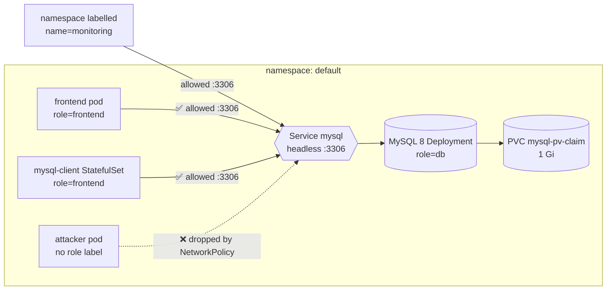

# 🛡️ MySQL on Kubernetes: network segmentation lab

**Can a compromised pod reach your database?** This lab deploys MySQL 8 on Kubernetes with persistent storage and a Secret, locks it down with a **NetworkPolicy**, then proves the policy works with two pods: a legitimate `frontend` that gets in, and an `attacker` that is blocked.


---

## 🎯 What this lab demonstrates

- Running a stateful database on Kubernetes: **PersistentVolume / PersistentVolumeClaim**, `Recreate` rollout strategy, headless Service.
- Injecting credentials from a **Secret** with `secretKeyRef` instead of hard-coding them in the manifests.
- **Zero-trust networking** with a NetworkPolicy: once a pod is selected, everything not explicitly allowed is denied, for both ingress and egress.
- **Testing a security control by attacking it**: a policy is only proven when you have watched it block something.

## 🏗️ Architecture



## 📁 Manifests (apply in order)

| File | What it creates |
|---|---|
| `01-secret.yaml` | Secret `mysql-secret` (root password, database name) |
| `02-mysql-pv-claim.yaml` | PVC using the cluster's **default StorageClass** (cloud, k3s local-path, minikube) |
| `03-sql-volumes.yaml` | *Alternative to 02*: a `hostPath` PV + matching PVC (`storageClassName: standard`) for single-node labs |
| `04-statefulsets.yaml` | `mysql-client`: waits for MySQL, lists the databases, creates and reads a `confidential` table |
| `05-network-policies.yaml` | NetworkPolicy `db-restrict-policy` on pods labelled `role=db` |
| `06-deployment.yaml` | MySQL 8 Deployment + headless Service `mysql` |
| `07-pod-attacker.yaml` | `attacker` pod (non-root, read-only filesystem) without any allowed label |

`notes.txt` holds the raw test commands; `rename.yaml` is the bash helper used to number the files.

## 🔒 The policy, rule by rule

| Direction | Allowed | Why |
|---|---|---|
| Ingress :3306 | pods with `role=frontend` in the same namespace | the application tier |
| Ingress :3306 | any pod in a namespace labelled `name=monitoring` | metrics / exporters |
| Ingress :3306 | `172.17.0.0/16` except `172.17.1.0/24` | example of an `ipBlock` with a carved-out subnet |
| Egress | TCP 5978 to `10.0.0.0/24` only | the DB may only push to a backup / monitoring backend |
| Everything else | **denied** | default-deny as soon as the pod is selected |

## 🚀 Run it

### Prerequisites
A cluster whose **CNI enforces NetworkPolicies**: Calico, Cilium, or kind ≥ v0.24 (kindnet). With a CNI that ignores them (e.g. Flannel alone), the policy is accepted but has no effect, and the attacker test "passes" for the wrong reason.

### Deploy
```bash
kubectl apply -f 01-secret.yaml
kubectl apply -f 02-mysql-pv-claim.yaml     # or 03-sql-volumes.yaml, not both
kubectl apply -f 06-deployment.yaml
kubectl apply -f 05-network-policies.yaml
kubectl apply -f 04-statefulsets.yaml
kubectl rollout status deployment/mysql
kubectl logs -f statefulset/mysql-client    # SHOW DATABASES + the confidential table
```

### ✅ Test 1: the frontend gets in
```bash
kubectl run frontend --image=nicolaka/netshoot --restart=Never --labels="role=frontend" -- sleep 3600
kubectl exec -it frontend -- nc -vz -w 5 mysql 3306
# Connection to mysql 3306 port [tcp/mysql] succeeded!
```

### ❌ Test 2: the attacker is blocked
```bash
kubectl apply -f 07-pod-attacker.yaml
kubectl exec -it attacker -- bash -c 'timeout 5 bash -c "</dev/tcp/mysql/3306" && echo "OPEN (unexpected)" || echo "BLOCKED (expected)"'
# BLOCKED (expected)
```

### Prove it is the policy, not luck
```bash
kubectl delete networkpolicy db-restrict-policy
# re-run Test 2  →  OPEN : the policy was the only thing protecting the database
kubectl apply -f 05-network-policies.yaml
```

### Clean up
```bash
kubectl delete -f 07-pod-attacker.yaml -f 04-statefulsets.yaml -f 05-network-policies.yaml \
  -f 06-deployment.yaml -f 02-mysql-pv-claim.yaml -f 01-secret.yaml
kubectl delete pod frontend
```

## ⚠️ Lab shortcuts (not for production)

- The Secret is committed with a demo password. In real life: Sealed Secrets, External Secrets + Vault, or SOPS, and never `root` for applications.
- MySQL runs as a single `Deployment`. Production uses a `StatefulSet` or an operator (MySQL Operator, Percona) with backups.
- `hostPath` volumes (file 03) tie data to one node.
- Traffic between the client and MySQL is **not encrypted yet**: see the roadmap.

## 🗺️ Roadmap

- [ ] **TLS for MySQL**: certificates from cert-manager, `require_secure_transport=ON`, clients connecting with `--ssl-mode=VERIFY_IDENTITY`
- [ ] Dedicated app user with least privileges instead of `root`
- [ ] Default-deny policy for the whole namespace, plus explicit DNS egress
- [ ] Secrets from Vault through External Secrets
- [ ] Move MySQL to a StatefulSet with `volumeClaimTemplates`
- [ ] Automated test script (`make test`) running both checks and failing on regression

## 🧠 What I learned

- A NetworkPolicy does nothing until its `podSelector` matches the pod's labels, and nothing at all if the CNI does not enforce it.
- Ingress `from` entries are OR'ed, while `podSelector` + `namespaceSelector` inside the *same* entry are AND'ed. That one indentation level is a classic security bug.
- Security controls must be tested negatively: an attacker pod is the cheapest penetration test in Kubernetes.

---

Built by **Enrique Pierret**, Cloud/DevOps engineer (CKA, LFCS) · [enrique-pierret.com](https://enrique-pierret.com) · [LinkedIn](https://www.linkedin.com/in/enrique-pierret-1b97502b)
